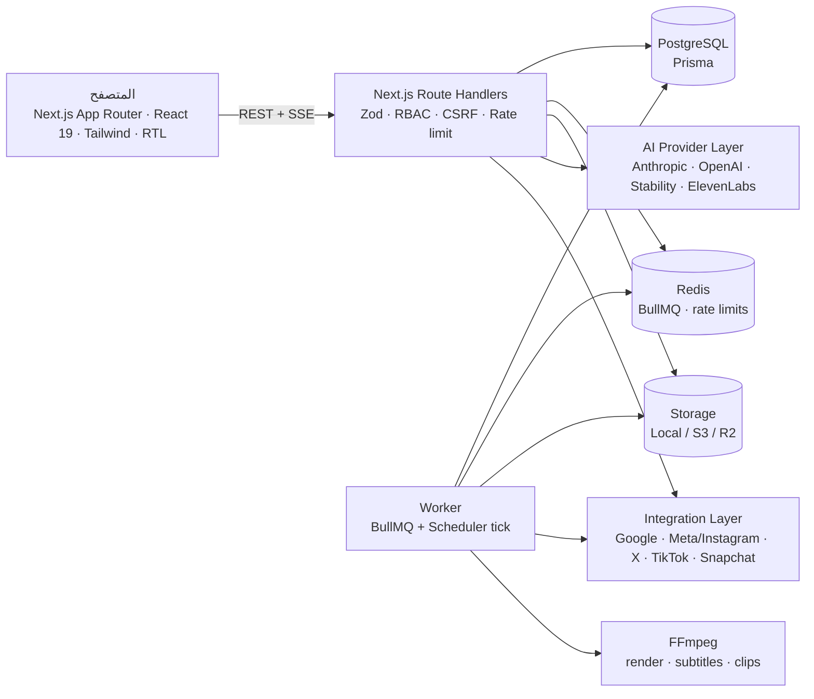
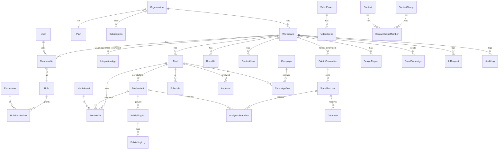

# AI Social Studio — استوديو المحتوى الذكي

> **من فكرة واحدة إلى محتوى متكامل عبر جميع منصاتك.**
> منصة SaaS لإدارة حسابات التواصل الاجتماعي وصناعة المحتوى النصي والتصاميم والفيديو بالذكاء الاصطناعي، مع الجدولة والنشر الفعلي عبر الواجهات الرسمية، والحملات، والتحليلات — بواجهة عربية أولًا (RTL) مع دعم الإنجليزية والوضع الداكن.

**اسم مقترح للمنتج:** «صدى — Sada Studio» (فكرتك تتردد في كل منصة). الاسم والشعار واللون الرئيسي قابلة للتغيير من *الإعدادات ← عام والهوية* دون تعديل الكود.

تجربة المستخدم: **أكتب فكرتي ← ابتكر المحتوى ← أنشئ التصميم والفيديو ← اختر المنصات ← راجع ← جدول أو انشر ← حلّل النتائج.**

---

## التشغيل السريع

### بـ Docker
```bash
cp .env.example .env && sed -i "s|^ENCRYPTION_KEY=.*|ENCRYPTION_KEY=\"$(openssl rand -base64 32)\"|" .env
docker compose up --build       # web على http://localhost:3000 + worker + postgres + redis
```

### محليًا
المتطلبات: Node 22، PostgreSQL 16، Redis 7، FFmpeg (مع libass) وخط يدعم العربية (DejaVu Sans).
```bash
npm ci
cp .env.example .env            # اضبط DATABASE_URL و REDIS_URL و ENCRYPTION_KEY
npx prisma migrate deploy && npm run db:seed   # الصلاحيات والخطط فقط — لا بيانات تجريبية
npm run build && npm start      # التطبيق
npm run worker                  # العامل: النشر، الجدولة، إخراج الفيديو، المزامنة، البريد
```
ثم افتح `/register` — أول مستخدم يصبح مالك المؤسسة. اتبع شاشة **البدء** (`/onboarding`): الهوية التجارية ← مفاتيح الذكاء الاصطناعي ← تطبيقات المطورين لكل منصة ← ربط الحسابات.

> لا يحتاج المستخدم إلى معرفة تقنية: كل مفاتيح API وبيانات تطبيقات OAuth تُدخل من لوحة الإعدادات وتُخزن مشفرة. يمكن بدلًا من ذلك ضبطها كمتغيرات بيئة.

### الاختبارات
```bash
npm test          # vitest: التشفير/TOTP، حدود المنصات، إعادة المقاسات، MIME البريد، آلة حالات النشر (على قاعدة بيانات حقيقية)
npm run typecheck
```
اختبار شامل لمسار الذكاء الاصطناعي دون مفاتيح حقيقية: `node tests/mocks/mock-ai-server.mjs 4010` ثم شغّل التطبيق والعامل مع
`AI_ANTHROPIC_BASE_URL=http://127.0.0.1:4010 AI_OPENAI_BASE_URL=http://127.0.0.1:4010/v1` واضبط مفتاح Anthropic على `sk-ant-mock`. (أداة اختبار فقط — لا تُستخدم في الإنتاج.)

---

## البنية التقنية



| الطبقة | الاختيار | السبب |
|---|---|---|
| الواجهة | Next.js 15 (App Router) + TypeScript + Tailwind + lucide + Recharts | SSR + API في مشروع واحد، RTL أصلي عبر `dir`، مكونات خفيفة |
| الخادم | Next.js Route Handlers (`app/api/**`) | كل نقطة تمر بـ `route()` الموحد: تحقق Zod، أخطاء واضحة بالعربية، صلاحيات على الخادم |
| قاعدة البيانات | PostgreSQL + Prisma (`prisma/schema.prisma`) | علاقات وفهارس وعزل كامل بين مساحات العمل |
| المهام | Redis + BullMQ + مؤقت جدولة كل 30 ث | قاعدة البيانات مصدر الحقيقة للمواعيد؛ BullMQ للتنفيذ وإعادة المحاولة |
| التخزين | محرك تخزين مجرد: Local أو S3-compatible (R2/MinIO) | `lib/storage` + روابط موقعة مؤقتة للمنصات التي تسحب الوسائط بالرابط |
| الذكاء الاصطناعي | طبقة مزودين قابلة للتبديل `lib/ai` | LLM / صور / TTS / STT — تغيير المزود من الإعدادات دون كود |
| الفيديو | FFmpeg (libass + harfbuzz للعربية) | إخراج حقيقي: Ken-Burns للصور، مسارات صوت، موسيقى، ترجمة مدمجة، قص 9:16 |

### هيكل المجلدات
```
app/(auth)            تسجيل الدخول/التسجيل/MFA
app/(app)/*           صفحات المنصة (15 قسمًا + الأفكار + البريد + البدء)
app/api/**            واجهات REST (route handlers)
lib/ai                مزودو الذكاء الاصطناعي + الخدمات + مخططات JSON المنظمة
lib/integrations      تكامل مستقل لكل منصة (OAuth، توكنات، API client، نشر، مقاييس)
lib/publishing.ts     التحقق قبل النشر، الجدولة، تنفيذ المهام وآلة الحالات
lib/video.ts          التعليق الصوتي، الإخراج، الترجمة، القص
lib/design.ts         نموذج مستند التصميم، توليد التخطيط، إعادة المقاسات الذكية
worker/index.ts       العامل في الخلفية
prisma/schema.prisma  مخطط قاعدة البيانات (≈40 جدولًا)
```

---

## واجهات المنصات المتاحة فعليًا (APIs الرسمية فقط)

| المنصة | الربط | النشر | الجدولة | التحليلات | التعليقات/الرسائل | ملاحظات وقيود |
|---|---|---|---|---|---|---|
| **Gmail** | Google OAuth 2.0 + PKCE (`gmail.send`, `gmail.compose`) | ✅ `users.messages.send` / `drafts.create` | ✅ عبر العامل | ❌ لا يوفر Gmail API تتبع الفتح/النقر | ❌ قراءة البريد نطاق *restricted* يتطلب تقييمًا أمنيًا | حد Google ≈500/يوم (شخصي) و2000 (Workspace) — حد يومي قابل للضبط + `List-Unsubscribe` + رابط إلغاء اشتراك إلزامي |
| **Instagram** | *Instagram API with Instagram Login* (توكن طويل 60 يومًا يُجدد تلقائيًا) | ✅ صورة، Carousel (≤10)، Reels، Stories عبر `/{ig-user-id}/media` ← `media_publish` | ✅ عبر العامل | ✅ `insights` (reach, likes, comments, shares, saved, views) | ✅ تعليقات + رد · ❌ الرسائل (Advanced Access) | حسابات Business/Creator فقط · App Review لصلاحيات النشر · الوسائط تُسحب عبر رابط عام موقع (`PUBLIC_MEDIA_BASE_URL` يجب أن يكون HTTPS عامًا) |
| **X** | OAuth 2.0 + PKCE (`tweet.write`, `media.write`, `offline.access`) | ✅ تغريدة، سلسلة (ردود متتابعة)، صور/فيديو (رفع مجزأ v2)، استطلاع | ✅ | ✅ `public_metrics` | ❌ قراءة الردود تتطلب خطة مدفوعة | الكتابة تتطلب خطة X API مناسبة · عدّ الأحرف الموزون (الروابط = 23) مطبق |
| **TikTok** | Login Kit v2 | ✅ Content Posting API (Direct Post، رفع FILE_UPLOAD مجزأ + تتبع الحالة) | ✅ | ✅ `video/query` | ❌ لا API للتعليقات | قبل تدقيق التطبيق تُنشر الفيديوهات بخصوصية `SELF_ONLY` — نقرأ `creator_info` ونختار خصوصية مسموحة |
| **YouTube** | Google OAuth (`youtube.upload`, `youtube.force-ssl`) | ✅ رفع قابل للاستئناف، Shorts، Thumbnail، قوائم التشغيل | ✅ + جدولة YouTube الأصلية `publishAt` | ✅ إحصاءات القناة والفيديو | ✅ تعليقات + رد | كل رفع ≈1600 وحدة من حصة 10,000 اليومية الافتراضية · الـ Thumbnail يتطلب قناة موثقة |
| **Snapchat** | Marketing API OAuth | ❌ **لا API رسمية للنشر العضوي** ← حزمة نشر يدوي (نص + ملفات + خطوات + تأكيد برابط) | تذكير في الموعد | ✅ إحصاءات الحملات الإعلانية | ❌ | إدارة الحملات الإعلانية (عرض + إنشاء حملة متوقفة) عبر Marketing API |

**قاعدة صارمة:** لا تظهر حالة «منشور» إلا بعد أن تعيد المنصة معرّف المنشور. المنصات التي لا تتيح النشر تتحول إلى `manual_required` ولا تُعلَّم منشورة إلا بتأكيد المستخدم. صفحة الرسائل والتعليقات تعرض كل قناة مع ما هو مدعوم فعليًا فقط.

### الخدمات التي تحتاج مفاتيح
| الخدمة | ما تحتاجه | أين |
|---|---|---|
| Google Cloud | OAuth Client (Web) + تفعيل Gmail API و YouTube Data API v3 + التحقق من التطبيق للنطاقات الحساسة | الإعدادات ← التكاملات |
| Meta for Developers | تطبيق Business + منتج Instagram + App Review | ″ |
| X Developer Portal | مشروع + تطبيق OAuth 2.0 (Confidential) + خطة تسمح بالكتابة | ″ |
| TikTok for Developers | Login Kit + Content Posting API + تدقيق التطبيق للنشر العام | ″ |
| Snapchat Business | OAuth App للـ Marketing API | ″ |
| Anthropic | مفتاح API (النصوص، المساعد، الخطط، التحليل) | الإعدادات ← الذكاء الاصطناعي |
| OpenAI | مفتاح API (الصور `gpt-image-1`، TTS، Whisper) | ″ |
| Stability / ElevenLabs | اختياري — بدائل للصور والتعليق الصوتي العربي | ″ |

رابط إعادة التوجيه لكل منصة يظهر في صفحة التكاملات بصيغة `APP_URL/api/oauth/{provider}/callback`.

---

## طبقة الذكاء الاصطناعي

| القدرة | المزود الافتراضي | البدائل | الاستخدام |
|---|---|---|---|
| نماذج لغوية | Anthropic `claude-opus-5-5` (adaptive thinking، structured outputs بمخطط JSON، streaming، fallback عند الرفض) | OpenAI | حزمة المحتوى لكل المنصات، إعادة الصياغة، الأفكار، خطط الحملات، سيناريو الفيديو، نصوص التصميم، تصنيف التعليقات واقتراح الردود، تحليل الأداء، المساعد (SSE) |
| توليد الصور | OpenAI `gpt-image-1` | Stability AI | صور المنشورات، خلفيات التصاميم، صور مشاهد الفيديو (تُقص للمقاس المطلوب) |
| نص ← صوت | OpenAI TTS | ElevenLabs (متعدد اللغات، أفضل للعربية) | التعليق الصوتي لكل مشهد وضبط مدته تلقائيًا |
| صوت ← نص | OpenAI Whisper | — | الترجمة التلقائية واستخراج المقاطع القصيرة |

كل طلب يُسجل في `AIRequest` (المزود، النموذج، الرموز، الزمن، الخطأ) ويُحتسب في `AIUsage` لحدود الخطة. الهوية التجارية (النبرة، الجمهور، الكلمات الممنوعة، اللهجة…) تُحقن تلقائيًا في كل طلب. المساعد يتلقى بيانات مساحة العمل الفعلية فقط ويُمنع من اختلاق أرقام.

---

## قاعدة البيانات (ERD مختصر)



جميع الجداول المطلوبة موجودة (Users, Organizations, Workspaces, SocialAccounts, OAuthConnections, BrandKits, ContentProjects, ContentIdeas, Posts, PostVariants, PostMedia, MediaAssets, DesignProjects, VideoProjects, VideoScenes, Campaigns, CampaignPosts, Schedules, PublishingJobs, PublishingLogs, AnalyticsSnapshots, Comments, Messages, Contacts, EmailCampaigns, EmailTemplates, AIRequests, AIUsage, Notifications, Approvals, Roles, Permissions, AuditLogs, Settings) إضافةً إلى Sessions, OAuthState, IntegrationApp, ContactGroup(Member), Task, ChatThread, Plan, Subscription.

---

## مراحل التنفيذ والحالة

| المرحلة | المحتوى | الحالة |
|---|---|---|
| 1. Core Platform | المستخدمون + MFA، لوحة التحكم، قاعدة البيانات، الحسابات، Brand Kit، مكتبة الملفات، الأفكار، المنشورات، التقويم | ✅ مُنفذة ومختبرة |
| 2. AI Content | مولد المحتوى متعدد المنصات (10 أساليب، لهجات عربية)، إعادة الصياغة، المساعد بالبث، خطط الحملات | ✅ (مختبرة بخادم محاكاة لواجهة Anthropic) |
| 3. AI Design | توليد التصميم بالذكاء الاصطناعي، محرر مرئي (نصوص، خطوط، ألوان، خلفيات، صور، أشكال، QR، إطارات، ظلال، طبقات، تراجع/إعادة)، 10 مقاسات، قوالب، إعادة المقاسات الذكية، تصدير PNG/JPEG للمكتبة | ✅ |
| 4. AI Video | السيناريو والمشاهد والـ Hook، صور المشاهد، التعليق الصوتي، الموسيقى، الترجمة SRT المدمجة، Timeline، الإخراج بـ FFmpeg، من صور/مقال، فيديو طويل ← مقاطع 9:16 | ✅ (الإخراج مختبر فعليًا) |
| 5. Integrations | Gmail، Instagram، X، TikTok، YouTube، Snapchat — كل منها مستقل | ✅ مكتوبة وفق الوثائق الرسمية · ⚠️ لم تُختبر ضد الخوادم الحية (انظر أدناه) |
| 6. Publishing | الجدولة، النشر، التحقق، إعادة المحاولة مع backoff، الأخطاء، حزمة النشر اليدوي | ✅ آلة الحالات مختبرة |
| 7. Analytics | جمع البيانات كل 6 ساعات، التقارير حسب المنصة/النوع/الفترة، CSV، توصيات الذكاء الاصطناعي، أفضل الأوقات من البيانات الفعلية | ✅ |
| 8. SaaS | الخطط والحدود (مفروضة على الخادم)، الاشتراكات، تعدد المؤسسات/مساحات العمل | ✅ الأساس · ⏳ بوابة الدفع ولوحة مدير النظام العامة |

### ما لم يُتحقق منه في بيئة البناء
بيئة التطوير معزولة شبكيًا عن خوادم المنصات ومزودي الذكاء الاصطناعي (`api.x.com` وغيرها غير قابلة للوصول)، ولا توجد مفاتيح حقيقية. لذلك:
- عملاء المنصات مكتوبون وفق الوثائق الرسمية ومُختبر سلوكهم عند الأخطاء (401 ← إعادة ربط، أخطاء شبكة ← إعادة محاولة)، لكن **يجب اختبار كل تكامل بحساب حقيقي وتطبيق مطور معتمد** قبل الإطلاق.
- مسار الذكاء الاصطناعي اختُبر كاملًا عبر خادم يحاكي بروتوكول Anthropic/OpenAI (بث SSE ومخرجات منظمة)، وليس عبر النماذج الحقيقية.

---

## المخاطر التقنية

| الخطر | الأثر | المعالجة |
|---|---|---|
| مراجعات التطبيقات (Meta App Review، TikTok audit، Google verification) | تأخير الإطلاق العام لأسابيع | التقديم مبكرًا؛ وضع تطوير بحسابات مختبرين؛ رسائل واضحة في الواجهة عن القيود |
| تغيّر الواجهات والإصدارات (Graph API versions، X API tiers) | فشل النشر | كل منصة في ملف مستقل؛ إصدار Graph قابل للضبط؛ سجلات عمليات وفحص صحة |
| حصص وحدود المعدل (YouTube 10k units، Gmail daily caps) | رفض الطلبات | backoff + احترام `retry-after`؛ حد يومي للبريد؛ أخطاء واضحة |
| انتهاء التوكنات/سحب الصلاحيات | توقف النشر | تجديد استباقي كل ساعة؛ حالة `needs_reauth` + إشعار |
| Instagram/TikTok تسحب الوسائط من رابط عام | فشل النشر محليًا | `PUBLIC_MEDIA_BASE_URL` HTTPS عام + روابط موقعة مؤقتة؛ أو S3/R2 |
| تكلفة نماذج الذكاء الاصطناعي | تكاليف عالية | حدود لكل خطة، سجل استهلاك، مستوى الجهد effort مضبوط لكل مهمة، إمكانية تغيير النموذج |
| حقوق الموسيقى والصور | مخالفات حقوق | الموسيقى مرفوعة من المستخدم فقط مع تنبيه الترخيص |
| جودة الصوت العربي | تجربة ضعيفة | دعم ElevenLabs متعدد اللغات كبديل |

---

## الأمان

تشفير التوكنات ومفاتيح API بـ AES-256-GCM · عدم تخزين كلمات مرور المنصات (OAuth فقط مع PKCE و`state` لمرة واحدة) · bcrypt لكلمات المرور · MFA (TOTP) · جلسات httpOnly قابلة للإلغاء · حماية CSRF (SameSite + فحص Origin) · CSP وترويسات أمان · Rate limiting عبر Redis · تحقق Zod لكل المدخلات · صلاحيات على الخادم لكل نقطة · عزل كامل بين المؤسسات · Audit log · فحص الملفات بالـ magic bytes وتحويل SVG إلى PNG · تسليم الملفات بترويسة `sandbox` · روابط وسائط موقعة ومؤقتة · المفاتيح لا تصل للمتصفح أبدًا · حذف كامل للمؤسسة مع إلغاء صلاحيات OAuth وحذف الملفات.

النسخ الاحتياطي: `pg_dump` مجدول لقاعدة البيانات + Versioning على حاوية S3/R2.

## النشر للإنتاج
1. PostgreSQL و Redis مُدارين، وتخزين S3/R2 (`STORAGE_DRIVER=s3`).
2. `APP_URL` و `PUBLIC_MEDIA_BASE_URL` بنطاق HTTPS عام (مطلوب لـ OAuth وسحب الوسائط).
3. تشغيل حاويتين من نفس الصورة: الويب (`npm start`) والعامل (`npm run worker`) — العامل يحتاج FFmpeg.
4. خلف بروكسي HTTP للخروج: `NODE_USE_ENV_PROXY=1` مع `HTTPS_PROXY`.
5. سجّل روابط إعادة التوجيه في لوحة كل منصة وقدّم طلبات المراجعة.
